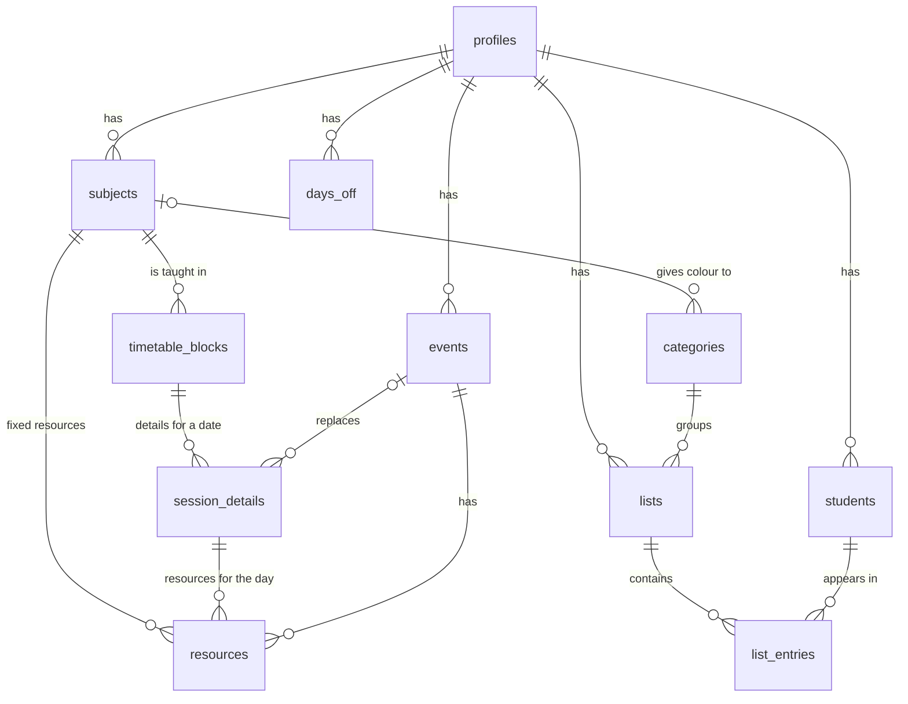

# 0002 – Modelo de datos

| | |
| --- | --- |
| **Estado** | Aceptada |
| **Fecha** | 13 de octubre de 2026 |
| **Basado en** | [Especificación v1.4](../spec/especificacion-v1.4.md) y [decisión 0001](0001-tech-stack.md) |

## Contexto

Los datos se guardan en Supabase (Postgres), asociados a la cuenta de cada profesora ([decisión 0001](0001-tech-stack.md)). Este documento define las tablas, sus relaciones, las reglas de acceso y las operaciones que se hacen en la base de datos. Sustituye a la descripción general del modelo que aparecía en la decisión 0001, que mencionaba opciones de lista que ya no existen.

El volumen es pequeño: unas pocas miles de filas por profesora y curso. El modelo prioriza la **integridad** y la **claridad** sobre el rendimiento.

## Diagrama

Por claridad, el diagrama omite que todas las tablas pertenecen a una usuaria (`user_id`).

## Reglas comunes

Se aplican a todas las tablas salvo `allowed_emails`:

- **Clave primaria `id`** de tipo `uuid`, generada por la base de datos. En `profiles`, el `id` es el de la usuaria en Supabase Auth.
- **`user_id uuid not null`**, con valor por defecto `auth.uid()` y clave ajena a `auth.users` con borrado en cascada: si se elimina una cuenta, desaparecen todos sus datos.
- **Row Level Security activada**, con una política para todas las operaciones: `user_id = auth.uid()` tanto para leer como para escribir.
- **Claves ajenas compuestas.** Cada tabla tiene una restricción única `(id, user_id)`, y las relaciones entre tablas usan el par `(x_id, user_id)`. Así es imposible, incluso conociendo un identificador ajeno, que una fila de una usuaria apunte a datos de otra.
- **`created_at` y `updated_at`** (`timestamptz`), mantenidos por la base de datos con un disparador.
- **Fechas del calendario como `date` y horas como `time`.** Los momentos (cuándo se archivó algo) como `timestamptz`.
- **Estados como fechas, no como booleanos:** un alumno dado de baja tiene `left_at`; una lista archivada, `archived_at`. Deshacerlo es volver a poner `null`.
- **Nombres en inglés y `snake_case`**, tablas en plural.

## Tablas

### `profiles`

La cuenta. Una fila por usuaria, creada al registrarse.

| Columna | Tipo | Reglas |
| --- | --- | --- |
| `id` | `uuid` | Clave primaria; es el `id` de `auth.users` |
| `name` | `text` | Obligatorio |
| `school_year_start` | `date` | Obligatorio. Para la profesora: 2026-09-07 |
| `school_year_end` | `date` | Obligatorio, posterior al inicio. Para la profesora: 2027-06-25 |

### `allowed_emails`

Correos que pueden registrarse en la v1.

| Columna | Tipo | Reglas |
| --- | --- | --- |
| `email` | `text` | Clave primaria, en minúsculas |
| `created_at` | `timestamptz` | |

Row Level Security activada **sin ninguna política**: la app no puede leerla ni modificarla. La mantiene el autor desde el panel de Supabase o con SQL.

### `subjects`

Asignaturas del horario, incluidos Registration, Break y Lunch.

| Columna | Tipo | Reglas |
| --- | --- | --- |
| `name` | `text` | Obligatorio; único por usuaria |
| `kind` | `text` | `'subject'` o `'break'`. Registration, Break y Lunch son `'break'` y no admiten recursos |
| `color` | `text` | Nombre de la paleta (ver "Colores"). Obligatorio si `kind = 'subject'`; `null` si es `'break'` |
| `sort_order` | `integer` | Orden en Settings → Subjects |

### `timetable_blocks`

El horario base: una asignatura en un día de la semana y una franja.

| Columna | Tipo | Reglas |
| --- | --- | --- |
| `subject_id` | `uuid` | Clave ajena a `subjects` |
| `weekday` | `smallint` | De 1 (lunes) a 5 (viernes) |
| `start_time` | `time` | |
| `end_time` | `time` | Posterior a `start_time` |

### `session_details`

Lo que la profesora añade a una sesión concreta. **Las sesiones no se guardan**: se calculan a partir del horario y la fecha. Solo existe una fila aquí cuando la sesión tiene notas, recursos del día o está anulada.

| Columna | Tipo | Reglas |
| --- | --- | --- |
| `block_id` | `uuid` | Clave ajena a `timetable_blocks` |
| `date` | `date` | Su día de la semana debe coincidir con el del bloque. Único junto con `block_id` |
| `notes` | `text` | Opcional |
| `cancelled_at` | `timestamptz` | `null` si no está anulada |
| `cancel_reason` | `text` | Obligatorio si está anulada |
| `replaced_by_event_id` | `uuid` | Clave ajena a `events`, opcional. El evento que la sustituyó, si lo hay |

### `events`

Eventos puntuales y actividades que sustituyen sesiones.

| Columna | Tipo | Reglas |
| --- | --- | --- |
| `name` | `text` | Obligatorio |
| `date` | `date` | Dentro del curso |
| `start_time` | `time` | |
| `end_time` | `time` | Posterior a `start_time` |
| `notes` | `text` | Opcional |

### `resources`

Todos los enlaces, en una sola tabla.

| Columna | Tipo | Reglas |
| --- | --- | --- |
| `subject_id` | `uuid` | Recurso fijo de una asignatura |
| `session_detail_id` | `uuid` | Recurso del día de una sesión |
| `event_id` | `uuid` | Recurso de un evento |
| `url` | `text` | Obligatorio, empieza por `http://` o `https://` |
| `title` | `text` | Opcional; si falta, la app muestra la URL |
| `sort_order` | `integer` | Orden dentro de su sesión, evento o asignatura |

- **Exactamente uno** de `subject_id`, `session_detail_id` y `event_id` está relleno. Lo garantiza una restricción `check (num_nonnulls(subject_id, session_detail_id, event_id) = 1)`.
- Las tres claves ajenas borran en cascada: si desaparece la sesión, el evento o la asignatura, desaparecen sus recursos.
- Una asignatura de tipo `'break'` no puede tener recursos; lo comprueba un disparador.
- El tipo de enlace (Drive, YouTube o genérico) **no se guarda**: se deduce de la URL al mostrarlo.

### `days_off`

Días sin clase.

| Columna | Tipo | Reglas |
| --- | --- | --- |
| `start_date` | `date` | |
| `end_date` | `date` | Igual o posterior a `start_date`. Para un solo día, igual |
| `name` | `text` | Opcional |

### `students`

| Columna | Tipo | Reglas |
| --- | --- | --- |
| `name` | `text` | Obligatorio. No es único: el aviso de nombre repetido es solo una advertencia de la app |
| `birthday_month` | `smallint` | De 1 a 12, opcional |
| `birthday_day` | `smallint` | De 1 a 31, opcional. Los dos campos del cumpleaños van juntos (ambos o ninguno), y la combinación debe existir en un año bisiesto (se admite el 29 de febrero) |
| `takes_bus` | `boolean` | Por defecto `false` |
| `observations` | `text` | Por defecto vacío |
| `left_at` | `timestamptz` | Fecha de baja; `null` si está en la clase |

No se guarda el año de nacimiento, ni apellidos completos, ni ningún dato sensible.

### `categories`

Categorías de las listas. Se crean las 16 al registrarse.

| Columna | Tipo | Reglas |
| --- | --- | --- |
| `name` | `text` | Obligatorio; único por usuaria |
| `subject_id` | `uuid` | Asignatura vinculada, si la hay. La categoría toma su color |
| `color` | `text` | Color propio, solo para las que no son asignaturas (Assembly y Others) |
| `sort_order` | `integer` | Orden en los desplegables |

Exactamente uno de `subject_id` y `color` está relleno. Si la profesora cambia el color de Maths, la categoría Maths cambia con él sin tocar esta tabla.

### `lists`

| Columna | Tipo | Reglas |
| --- | --- | --- |
| `name` | `text` | Obligatorio |
| `category_id` | `uuid` | Clave ajena a `categories`. No se puede borrar una categoría con listas |
| `archived_at` | `timestamptz` | `null` si está activa |

La fecha que se muestra en las tarjetas y que usa el filtro por mes es `created_at`.

### `list_entries`

Un alumno dentro de una lista.

| Columna | Tipo | Reglas |
| --- | --- | --- |
| `list_id` | `uuid` | Clave ajena a `lists`, borrado en cascada |
| `student_id` | `uuid` | Clave ajena a `students`, borrado en cascada. Único junto con `list_id` |
| `checked_at` | `timestamptz` | Cuándo se marcó la casilla; `null` si está sin marcar. La app no lo muestra, pero se guarda como fecha por coherencia con el resto del modelo |
| `note` | `text` | Opcional |
| `removed_at` | `timestamptz` | Cuándo se quitó de la lista; `null` si está en ella |

- **Quitar y volver a añadir** solo cambia `removed_at`, así que se conservan la casilla y la nota.
- **"Left"** no se guarda aquí: se deduce de `students.left_at`.
- **Progreso de la lista:** filas con `checked_at` relleno sobre el total, contando solo filas con `removed_at` vacío y alumnos con `left_at` vacío.

## Colores

Los colores se guardan como **nombres de la paleta**, no como códigos hexadecimales. Los tonos de cada nombre (cabecera, cuerpo y texto) se definen en el código según el brief.

- **Asignaturas:** 16 nombres, uno por cada pastel del brief (hay 14 asignaturas, así que dos colores empiezan sin usar). Son **nombres de color neutros** (por ejemplo, `slate`, `sky`, `rose`, `lime`), no nombres de asignatura: si la profesora pone a Music el mismo color que a English, las dos guardan el mismo nombre. La lista exacta y su correspondencia con la tabla del brief se fijan en la tarea de base de datos.
- **Categorías propias:** dos nombres más para Assembly y Others.
- Una restricción `check` en cada columna de color impide guardar un nombre fuera de la paleta.

## Operaciones en la base de datos

Las operaciones que tocan varias tablas se hacen con **funciones SQL**, para que se apliquen enteras o no se apliquen. Se ejecutan con los permisos de la usuaria (`security invoker`), así que Row Level Security sigue aplicándose.

| Función | Qué hace |
| --- | --- |
| `cancel_session` | Anula una sesión (creando su `session_details` si no existe) con un motivo. Si se pide una actividad en su lugar, crea el evento y anula también las sesiones de ese día que se solapan con él, con el mismo motivo y `replaced_by_event_id` |
| `create_event` | Crea un evento y anula las sesiones que se solapan, igual que la anterior |
| `delete_event` | Borra un evento y, si se pide, restaura las sesiones que sustituía (pone a `null` su anulación) |
| `create_list` | Crea una lista y una fila de `list_entries` sin marcar por cada alumno con `left_at` vacío |

**Regla de solape:** un bloque se solapa con un evento si `bloque.inicio < evento.fin` y `evento.inicio < bloque.fin`. Los bloques de tipo `'break'` no se anulan nunca: simplemente quedan cubiertos.

Las operaciones sencillas (restaurar una sesión, marcar una casilla, editar un alumno) se hacen directamente sobre la tabla.

## Registro y datos iniciales

1. **Correos autorizados.** Antes de crear una usuaria, la base de datos comprueba que su correo está en `allowed_emails`. Si no está, el registro se rechaza y la app muestra "This email doesn't have access to ClassFlow yet." El mecanismo exacto (un *hook* de Supabase Auth previo a la creación de la usuaria, o un disparador) se decide en la tarea de implementación.
2. **Datos iniciales automáticos.** Al crearse la usuaria, una función crea en una sola transacción:
    - Su fila de `profiles`, con el nombre del formulario y las fechas del curso.
    - Las 14 asignaturas con sus colores iniciales, más Registration, Break y Lunch.
    - Los bloques del horario de la [especificación](../spec/especificacion-v1.4.md#horario-base-de-la-clase).
    - Las 16 categorías.
3. En la v1, ese horario es el de la profesora, porque es la única autorizada. Cuando exista el editor de horario, la función creará un horario vacío o una plantilla.
4. El horario y los colores iniciales viven en una **migración**, no en el código del frontend.

## Exportar los datos

"Export my data" lee todas las tablas de la usuaria y genera en el navegador un archivo JSON con:

- Un campo `version` con el número de versión del formato, para poder importarlo en el futuro.
- La fecha de exportación.
- Una sección por tabla, sin `user_id` (es redundante).

No se exporta `allowed_emails`.

## Índices

Además de las claves primarias y las restricciones únicas, índices en:

- Todas las claves ajenas.
- `session_details (user_id, date)`, `events (user_id, date)` y `days_off (user_id, start_date)`, porque el Planning consulta por rangos de fechas.

## Alternativas descartadas

| Alternativa | Por qué se descarta |
| --- | --- |
| Guardar todas las sesiones del curso como filas | Unas 1.500 filas vacías por profesora, y un cambio de horario obligaría a regenerarlas |
| Tres tablas de recursos (de asignatura, de sesión y de evento) | Triplica el código para añadir, editar y borrar enlaces |
| Una tabla de recursos con un tipo en texto y un identificador genérico | Pierde las claves ajenas: la base de datos no garantizaría que el recurso apunta a algo que existe |
| Categorías como lista fija en el código | El color de las categorías de asignatura tendría que buscarse por nombre, y no se podrían editar en el futuro |
| Colores como código hexadecimal | No permite derivar los tres tonos ni retocar la paleta sin migrar datos |
| Booleanos para los estados (`is_checked`, `is_archived`) | Se pierde cuándo ocurrió, y las fechas ocupan lo mismo |
| Fechas del curso fijas en el código | No sirven para otras profesoras ni para otro curso |
| Datos iniciales con un script manual | Exige un paso del autor y la profesora vería la app vacía mientras tanto |
| Filtrar por usuaria solo en el frontend | Un error en el código expondría los datos de otra profesora. Row Level Security lo garantiza en la base de datos |

## Consecuencias

- La lógica de calcular las sesiones de una semana o de un día vive en el frontend (`features/planning/lib/`), combinando bloques, detalles de sesión, eventos y días sin clase. Es la pieza que más pruebas necesita.
- Las cuatro funciones SQL concentran las reglas de solape y de creación de listas; deben tener pruebas propias en la tarea que las implemente.
- Añadir una tabla o una columna exige una migración, regenerar los tipos y actualizar este documento.
